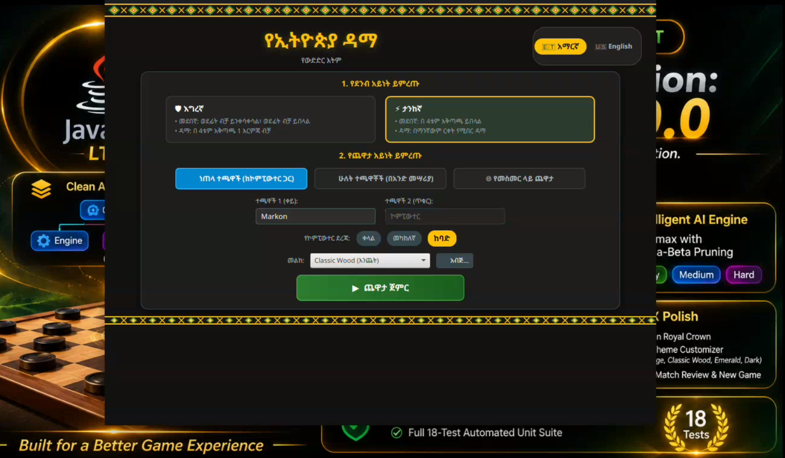
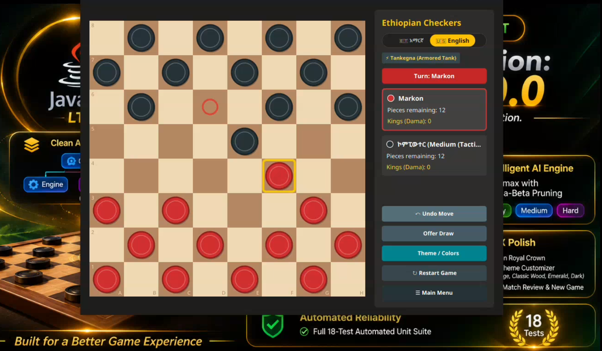
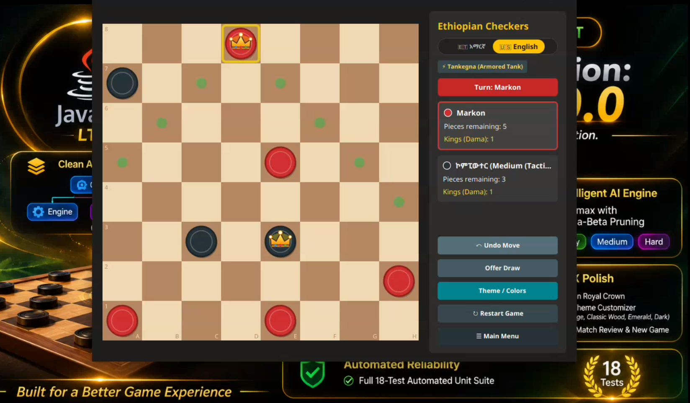
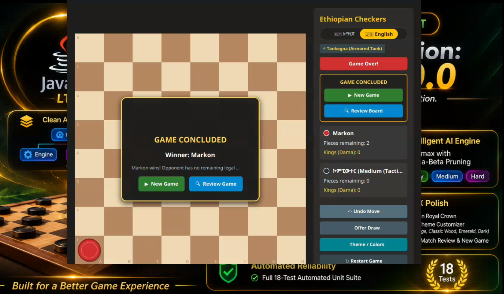
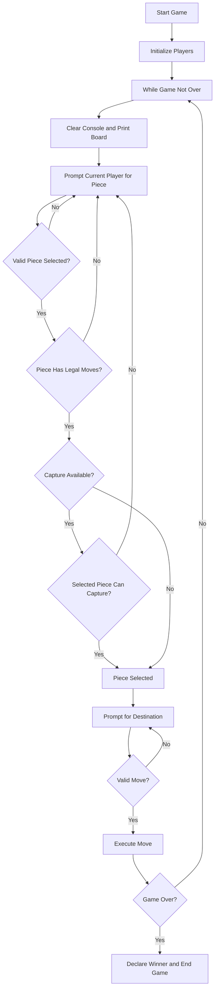
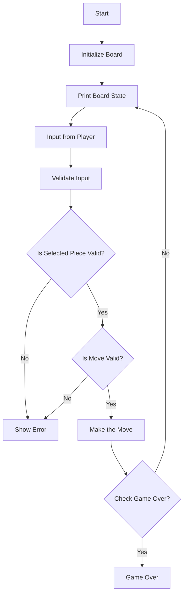

# Ethiopian Checkers Game (Dama / የኢትዮጵያ ዳማ) v2.0

An authentic, modernized implementation of traditional Ethiopian Checkers (Dama) featuring **Player vs Computer (AI)** and **Two-Player Local Play**, available in both an interactive JavaFX GUI and a text-based Terminal interface.

---

## What's New in v2.0
* **Selectable Rule Modes (Strategy Pattern)**:
  * **Egregna (እግረኛ - Foot Soldier Mode)**:
    * Regular piece moves and captures **forward only**.
    * King piece (**Short King**) moves and captures **1 square** in all 4 diagonal directions (cannot slide over distance).
  * **Tankegna (ታንከኛ - Armored Tank Mode)**:
    * Regular piece moves forward, captures in **all 4 diagonal directions** (both forward and backward with direction changes during multi-jump).
    * King piece (**Flying King / Dama**) slides any number of squares and captures over distance, landing on any open square behind.
    * Configurable `promoteMidJump` flag (standard `false`: continues regular jump, promotes at turn end).
    * Pending removal tracking prevents pieces from being jumped twice within the same multi-jump sequence.
* **Computer / AI Opponent**: Play against an AI with 3 difficulty modes: **Easy**, **Medium (Tactical Minimax)**, and **Hard (Alpha-Beta Pruning with Board Control Heuristics)**.
* **Theme & Color Customization**:
  * 5 built-in themes: *Classic Wood*, *Ethiopian Heritage*, *Modern Tournament*, *Midnight Dark*, and *Forest Emerald*.
  * Custom palette dialog allowing players to customize board light/dark squares and player 1/2 piece colors live during gameplay.
* **Intelligent Draw (Tie) Engine**:
  * **Automatic Insufficient Material**: Detects mathematically unwinnable endgames (e.g. 1 King vs 1 King) and concludes match immediately as a draw.
  * **Threefold Repetition**: Full board state fingerprinting prevents infinite cycle loops and declares a draw when the identical position occurs 3 times.
  * **50-Ply No-Progress Rule**: Declares a draw if 25 consecutive turns (50 plies) elapse without any captures or regular piece advances.
  * **Interactive Draw Offers**: Both players in Human vs Human can propose mutual draws; against Computer AI, the AI evaluates positional advantage via `BoardEvaluator`—accepting when balanced or losing, and declining when in a winning position.
* **Bilingual Language Toggle (አማርኛ 🇪🇹 vs English 🇺🇸)**:
  * Strict internationalization separating Amharic and English without mixed text.
  * Live toggle pill switch available on the startup menu and in-game control sidebar.
* **Online Multiplayer & Matchmaking**:
  * **⚡ Quick Match (ፈጣን ግጥሚያ)**: 1-click public matchmaking queue that automatically pairs players anywhere on the internet without needing room codes.
  * **🔒 Private Room (ከጓደኛ ጋር)**: Create or join custom matches with 4-digit room codes (e.g. `#4821`).
  * **Zero-Configuration Fallback**: Built-in embedded relay server automatically boots up if no external relay is found.
* **Authentic Ethiopian Cultural Onboarding UI**:
  * Procedural **Tibeb (ጥበብ)** geometric textile ribbon patterns across the interface.
  * Pure Ge'ez/Amharic typography in Amharic mode (*የኢትዮጵያ ዳማ*, *እግረኛ*, *ታንከኛ*, *ነጠላ ተጫዋች*, *ሁለት ተጫዋች*, *የመስመር ላይ*) and clear English typography in English mode.
  * Interactive cards for Solo Play, Pass & Play, and Online Matchmaking.
* **Non-Blocking Visual Feedback**: In the GUI, pieces with mandatory captures feature a subtle amber pulse (no disruptive modal popups).
* **Game Over Experience**: Post-match floating card with **New Game** and **Review Board** mode.

---

## Table of Contents
- [Requirements](#requirements)
- [Screenshots & Gallery](#screenshots--gallery)
- [How to Run](#how-to-run)
  - [JavaFX GUI Version](#javafx-gui-version)
  - [Terminal Version](#terminal-version)
  - [Running Unit Tests](#running-unit-tests)
- [System Architecture](#system-architecture)
- [Game Rules Summary](#game-rules-summary)
- [Version History & Git Tags](#version-history--git-tags)

---

## Requirements
- **Java**: Java 21 (LTS) or higher
- **Maven**: Maven 3.8+ (included via `./mvnw` wrapper)
- **JavaFX**: 17.0.6+ (managed automatically via Maven)

---

## How to Run

### JavaFX GUI Version
Run directly with the Maven wrapper:
```sh
./mvnw clean javafx:run
```
Or with an installed Maven:
```sh
mvn clean javafx:run
```

Or using the standard Java CLI directly from compiled classes:
```sh
java --module-path $(find ~/.m2/repository/org/openjfx -name "*17.0.6-linux.jar" | paste -sd: -) \
     --add-modules javafx.controls,javafx.fxml \
     -cp target/classes com.dama.ethiopiancheckersgame.EthiopianCheckersGame
```

### Terminal Version
Run from the command line:
```sh
./mvnw clean compile exec:java -Dexec.mainClass="com.dama.ethiopiancheckersgame.MainTerminal"
```
Or directly via Java CLI:
```sh
java -cp target/classes com.dama.ethiopiancheckersgame.MainTerminal
```

### Running Unit Tests
```sh
./mvnw test-compile
java -cp $(find ~/.m2/repository/org/junit ~/.m2/repository/org/opentest4j ~/.m2/repository/org/apiguardian ~/.m2/repository/org/openjfx -name "*.jar" | paste -sd: -):target/classes:target/test-classes com.dama.ethiopiancheckersgame.TestRunner
```

---

## Screenshots & Gallery

### 🌟 Version 2.0 (Modernized Tournament Edition)

#### 1. Cultural Onboarding & Language Toggle
Authentic Ethiopian Tibeb (ጥበብ) decorative geometric textile banner, bilingual Language Toggle (`[ 🇪🇹 አማርኛ | 🇺🇸 English ]`), selectable Rule Variants (**እግረኛ** vs. **ታንከኛ**), and Mode Cards (Solo AI, Pass & Play, Online).


---

#### 2. Game Arena & First Move
Tournament board canvas with real-time scorecards, active turn banner, pieces remaining, and non-blocking mandatory capture indicators.


---

#### 3. Promoted King with Golden Royal Crown
Vector-rendered royal golden crown on promoted Dama pieces with visual highlights for long-range flying moves and multi-jump combo captures.


---

#### 4. Game Concluded & Review Mode
Post-match conclusion overlay with winner/draw status, one-click **New Game** restart, and **Review Board** mode to study the match state.


---

### 🕰️ Version 1.0 (Legacy Baseline Comparison)
The original monolithic prototype before the clean architecture and AI modernization:
<p align="center">
  
  
</p>

---

## System Architecture

The codebase is organized into decoupled, independent modules:

```
com.dama.ethiopiancheckersgame/
├── core/
│   ├── model/         # Immutable models: Position, Piece, PieceColor, PieceType, Move, Board, GameState
│   └── rules/         # RuleStrategy: EgregnaRules (Short King) & TankegnaRules (Flying King)
├── player/            # Player interface, HumanPlayer, NetworkPlayer
│   └── ai/            # AIPlayer, AIDifficulty, MinimaxEngine (Alpha-Beta), BoardEvaluator
├── engine/            # GameSession (turn loop, undo stack), GameMode, DrawDetector, GameEventListener
├── network/           # MatchmakingServer, NetworkClient, NetworkProtocol, NetworkEventListener
└── ui/
    ├── gui/           # JavaFX: EthiopianCheckersApp, StartMenu, GameScene, BoardCanvas, ControlPanel, 
    │                  # TibebBanner, LanguageToggleBar, Theme, ThemeCustomizerDialog
    ├── i18n/          # I18n localization engine, Language enum (AMHARIC, ENGLISH)
    └── cli/           # TerminalGame, MainTerminal (Headless ANSI interface)
```

---

## Version History & Git Tags
* `v1.0.0-legacy`: Original baseline implementation.
* `v2.0.0`: Upgraded architecture, Java 21 LTS support, AI player (Minimax + Alpha-Beta), authentic Ethiopian Dama rules engine, and modern GUI with mandatory capture visual indicators.

---

## How to Collaborate

1. **Fork** the repository on GitHub.
2. **Clone** your fork:
   ```sh
   git clone https://github.com/yourusername/EthiopianCheckersGame.git
   cd EthiopianCheckersGame
   ```
3. **Create a new branch** for your feature or bugfix:
   ```sh
   git checkout -b feature/my-feature
   ```
4. **Make your changes** and commit with clear messages:
   ```sh
   git add .
   git commit -m "Describe your change"
   git push origin feature/my-feature
   ```
5. **Open a Pull Request** on GitHub.
6. Please follow code style and add comments. For major changes, open an issue first to discuss.

---

# System Documentation: Dama Ethiopian Checkers Game

## 1. System Overview
### **`General Description`**: 
a traditional Ethiopian Checkers game, Dama, is designed for offline, local multiplayer play.

**`Setup`**: The game is played on an 8x8 board with alternating dark and light squares (a 8x8 grid or matrix/2d array). Each player starts with 12 pieces, placed on the dark squares in their respective half of the board.

**`Turns`**: Players take turns moving their pieces diagonally forward across the dark squares.

**`Capturing`**: Players can jump over an opponent’s piece to capture it if the square beyond is empty. Capturing is mandatory if a capture move is available.

**`King Promotion`**: When a piece reaches the opponent’s back row, it is promoted to a King. Kings can move diagonally forwards and backward, offering more strategic options.

**`Winning the Game`**: The game ends when a player captures all of their opponent’s pieces or blocks them from making any legal moves.
## 2. Functional Requirements

### Core Requirements:
- Two players can play the game.
- Players can move pieces diagonally.
- Players can capture opponent pieces by jumping over them.
- Pieces can be promoted to kings when reaching the opposite end.
- Kings can move both forward and backward.
- Mandatory capture rules are enforced.
- Game ends when a player loses all pieces or has no valid moves.

### Player Interaction Requirements:
- Players can input their names.
- Players can select pieces using the coordinate system.
- Players can select destination moves.
- Players can view the current game state.
- Players receive feedback on invalid moves.

## 3. Non-Functional Requirements

### Performance:
- Instant response to player moves.
- Efficient board state validation.

### Usability:
- Clear board visualization.
- Intuitive coordinate input system.
- Informative error messages.

### Reliability:
- Input validation.
- Game state consistency.
- Thread-safe player management By using a concurrent HashMap.It allows for a multiple access without corrapting the data

### Maintainability:
- Modular design.
- Clear separation of concerns.
- Well-documented code.

## 4. Class Diagram

### Main Class

```
[Main]
├── Fields:
│   ├── SIZE: int
│   ├── board: char[][]
│   ├── player1Turn: boolean
│   ├── players: ConcurrentHashMap
│   ├── gameRunning: AtomicBoolean
│   ├── player1Pieces: int
│   └── player2Pieces: int
│
├── Inner Classes:
│   └── [Player]
│       ├── name: String
│       ├── symbol: char
│       └── kingSymbol: char
│
├── Game Logic Methods:
│   ├── initializeBoard()
│   ├── printBoard()
│   ├── makeMove()
│   ├── isValidMove()
│   └── isGameOver()
│
└── Helper Methods:
    ├── parseInput()
    ├── isValidPiece()
    ├── hasLegalMoves()
    └── hasCaptureMoves()
```

# Inheritance Structure:

# Player Class Hierarchy

## Abstract Class: `Player`
The `Player` class serves as an abstract base for defining common functionality and attributes shared by all players in the game.

### Attributes:
- `name` (String): The name of the player.
- `symbol` (char): The character symbol representing the player's regular pieces.
- `kingSymbol` (char): The character symbol representing the player's king pieces.

### Core Methods:
- `makeMove()`: Abstract method to define how a player makes a move.
- `getAvailableMoves()`: Retrieves all possible moves for the player.
- `promotePiece()`: Promotes a piece to a king when conditions are met.

---

## Class Hierarchy

### `Player1`
A concrete implementation of the `Player` class, representing Player 1.

- **Attributes**:
  - `name`: Name of Player 1.
  - `symbol`: 'O' (used for Player 1's regular pieces).
  - `kingSymbol`: 'K' (used for Player 1's king pieces).

- **Special Characteristics**:
  - Regular pieces are represented as `Player1Piece`.
  - Promoted pieces are represented as `Player1King`.

---

### `Player2`
A concrete implementation of the `Player` class, representing Player 2.

- **Attributes**:
  - `name`: Name of Player 2.
  - `symbol`: 'X' (used for Player 2's regular pieces).
  - `kingSymbol`: 'Q' (used for Player 2's king pieces).

- **Special Characteristics**:
  - Regular pieces are represented as `Player2Piece`.
  - Promoted pieces are represented as `Player2King`.

---

## Relationship with Pieces
The `Player` class interacts closely with the `Piece` hierarchy to manage game logic:

```
GameObject
└── Piece
    ├── RegularPiece
    │   ├── Player1Piece (O)
    │   └── Player2Piece (X)
    └── KingPiece
        ├── Player1King (K)
        └── Player2King (Q)
```

### Key Interactions:
- Players own pieces (`Player1` owns `Player1Piece` and `Player1King`; `Player2` owns `Player2Piece` and `Player2King`).
- Players are responsible for moving their pieces and promoting them to kings when they reach the opposite end of the board.





